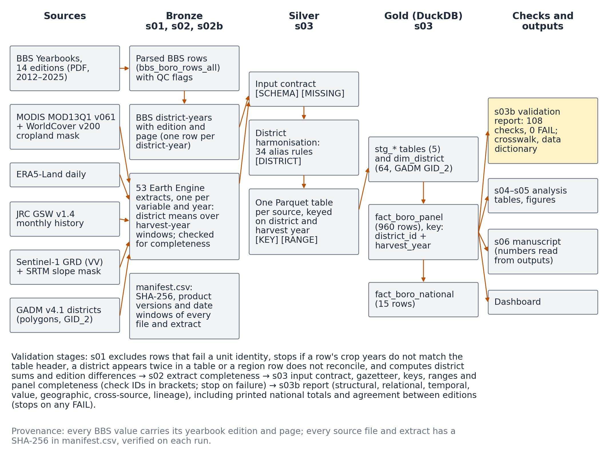
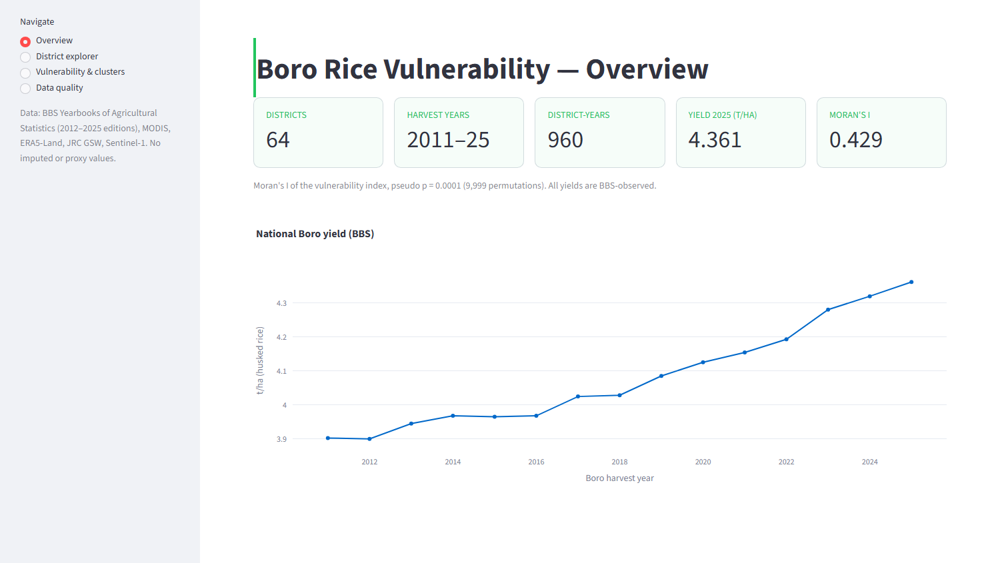

# bd-boro-data-framework

[](https://doi.org/10.5281/zenodo.23795046)
[](LICENSE)
[](v2/requirements-lock.txt)

An open, tested data engineering framework for integrating official crop
statistics with satellite and climate data, applied to district-level Boro
rice in Bangladesh: all 64 districts, harvest years 2011–2025.

Official agricultural statistics are often published only as PDF tables. Once
such tables are digitised, a misread cell, a crop year assigned to the wrong
season or a renamed district can leave a dataset that still has the expected
shape, so summary statistics do not reveal the error. This framework extracts
the district Boro rice tables from the Bangladesh Bureau of Statistics (BBS)
Yearbooks of Agricultural Statistics, checks every value against the
redundancy of the publications themselves, and aligns it by harvest year with
MODIS NDVI, ERA5-Land climate, and JRC and Sentinel-1 flood fractions. Only
values printed in the yearbooks are used; nothing is interpolated or imputed.
The checks are themselves tested by damaging the data on purpose, and the
outputs are rebuilt in new environments and compared file by file.

## At a glance

| | |
|---|---|
| **Spatial unit** | 64 districts (GADM v4.1 level 2) |
| **Period** | 15 Boro seasons, harvest years 2011–2025 |
| **Gold panel** | 960 district-years, each value traceable to its yearbook edition and page |
| **Statistics** | 14 yearbook editions (2012–2025); 4 of 1,726 district rows failed a unit identity and were excluded and logged, and every district-year was still covered by another edition |
| **Covariates** | 53 Earth Engine extracts: NDVI, climate, and two flood records kept as separate series |
| **Validation** | 108 checks: 107 PASS, 1 INFO (the 4 excluded rows), 0 FAIL |
| **Failure tests** | 10 of 10 deliberately damaged runs detected, plus a clean baseline |
| **Reproducibility** | Rebuilt in 2 new environments: 57 files compared, 0 different |
| **Stack** | Python and DuckDB; runs in about 3 minutes on a desktop computer |

## Contents

- [How it works](#how-it-works)
- [Data sources](#data-sources)
- [Harvest-year alignment](#harvest-year-alignment)
- [Using the data without running anything](#using-the-data-without-running-anything)
- [Data model](#data-model)
- [Repository structure](#repository-structure)
- [Setup](#setup)
- [Running the pipeline](#running-the-pipeline)
- [Notebooks](#notebooks)
- [Dashboard](#dashboard)
- [How values are checked](#how-values-are-checked)
- [Evaluation](#evaluation)
- [Example application](#example-application)
- [Adapting the framework](#adapting-the-framework)
- [Limitations](#limitations)
- [Manuscript](#manuscript)
- [Citation](#citation)
- [Licence and data terms](#licence-and-data-terms)
- [Contact](#contact)

## How it works

The pipeline follows the Bronze–Silver–Gold layering:

- **Bronze** holds the sources as received: the rows parsed from the yearbook
  PDFs, the Earth Engine district extracts, and a manifest with the SHA-256
  checksum of every file.
- **Silver** holds one validated Parquet table per source, keyed on district
  and harvest year.
- **Gold** holds the integrated panel and the tables it is built from, in a
  DuckDB database read by the analyses and the dashboard.



Each step is a separate script. One file, `v2/src/schema.py`, specifies the
whole data model: the grain, key, columns, types and units of every table,
the plausible range of every variable, the harvest years in which each must be
present, and the version and availability of each source. The data dictionary
is generated from that file, and the same file drives the extraction settings,
the input checks and the validation report, so the documentation and the checks
cannot drift apart.

## Data sources

| Source | Provider | Resolution | Used for | Period used |
|---|---|---|---|---|
| Yearbook of Agricultural Statistics, 2012–2025 editions | Bangladesh Bureau of Statistics | 64 districts | harvested area, yield, production | crop years 2010-11 to 2024-25 |
| MODIS MOD13Q1 v061 | NASA LP DAAC, via Earth Engine | 250 m, 16-day | peak-season NDVI | Jan–Apr of each harvest year |
| ESA WorldCover v200 | European Space Agency, via Earth Engine | 10 m | cropland mask for NDVI | 2021 map, static |
| ERA5-Land daily aggregates | Copernicus Climate Change Service, via Earth Engine | 0.1° | temperature, precipitation, hot days | Nov 2010 – May 2025 |
| JRC Global Surface Water v1.4, monthly history | European Commission JRC, via Earth Engine | 30 m | flood fractions (Landsat) | to December 2021, when the product ends |
| Sentinel-1 GRD (IW, VV) | European Space Agency, via Earth Engine | 10 m, analysed at 60 m | flood fractions (radar) | from October 2014, when it begins over Bangladesh |
| SRTM GL1 | NASA/USGS, via Earth Engine | 30 m | slope mask for radar water detection | static |
| GADM v4.1, level 2 | GADM | 64 polygons | district boundaries, areas, stable identifiers | static |

The full inventory, with licences, is in
[`v2/docs/data_dictionary.md`](v2/docs/data_dictionary.md).

## Harvest-year alignment

Boro is grown from about November to May, so a BBS crop year spans two
calendar years. Every table is keyed on **harvest year t**, where BBS crop year
"(t−1)–t" has harvest year t: crop year 2012-13 is harvest year 2013. This
keeps each yield paired with the satellite and climate data of its own season.

| Variable | Panel columns | Window for harvest year t | Harvest years with values |
|---|---|---|---|
| Area, yield, production | `area_ha`, `yield_t_ha`, `production_t` | crop year (t−1)–t | 2011–2025 |
| NDVI | `ndvi_peak`, `ndvi_max` | Jan–Apr of t, cropland pixels only | 2011–2025 |
| Temperature, precipitation | `tmean_c`, `tmax_c`, `precip_mm` | Nov of t−1 to May of t | 2011–2025 |
| Hot days (above 35 °C) | `hot_days` | Mar–May of t | 2011–2025 |
| Monsoon flood, JRC | `jrc_monsoon_flood` | water in Jun–Oct of t−1, not in Jan–Mar of t−1 | 2011–2022 |
| Flash flood, JRC | `jrc_flash_flood` | water in Apr–May of t, not in Jan–Mar of t | 2011–2021 |
| Monsoon flood, Sentinel-1 | `s1_monsoon_flood` | as for JRC | 2016–2025 |
| Flash flood, Sentinel-1 | `s1_flash_flood` | as for JRC | 2015–2025 |

No single flood record covers the whole period. JRC and Sentinel-1 are kept as
separate series and are not spliced. Outside its coverage a flood variable is
missing (NULL), not zero.

The two flood records use the same windows but different dry-season baselines.
For JRC, a pixel counts as dry-season water if it was water in any month from
January to March. For Sentinel-1, it counts if its median backscatter over
January–March is below the −18 dB water threshold.

## Using the data without running anything

The outputs are in the repository, so you do not need the yearbooks, Earth
Engine or a full run to use them.

| To get | Open |
|---|---|
| The integrated panel | `v2/data/gold/bangladesh_agri_v2.duckdb`, table `fact_boro_panel` |
| One table per source | `v2/data/silver/*.parquet` |
| The BBS statistics as CSV | `v2/data/bronze/bbs/bbs_boro_district_year.csv` |
| The satellite and climate extracts | `v2/data/bronze/gee/` |
| Every district spelling and how it was resolved | `v2/mappings/district_crosswalk.csv` |
| The result of every validation check | `v2/outputs/validation_report.csv` |

For example, in Python, from the repository root:

```python
import duckdb

con = duckdb.connect("v2/data/gold/bangladesh_agri_v2.duckdb", read_only=True)
df = con.sql("""
    SELECT district, harvest_year, area_ha, yield_t_ha, ndvi_peak, bbs_edition, bbs_page
    FROM fact_boro_panel
    WHERE district = 'Sylhet'
    ORDER BY harvest_year DESC
    LIMIT 3
""").df()
print(df)
```

```text
  district  harvest_year  area_ha  yield_t_ha  ndvi_peak  bbs_edition  bbs_page
0   Sylhet          2025  85478.0       3.501   0.493239         2025        98
1   Sylhet          2024  82651.0       3.452   0.525211         2025        98
2   Sylhet          2023  82268.0       3.318   0.482768         2024        97
```

`bbs_edition` and `bbs_page` give the yearbook edition and PDF page each value
was read from, so any value can be checked against the printed table.

## Data model

The Gold database has 8 tables:

| Table | Grain | Rows | Contents |
|---|---|---|---|
| `fact_boro_panel` | district × harvest year | 960 | the integrated panel: BBS values with edition and page, NDVI, climate and flood variables |
| `fact_boro_national` | harvest year | 15 | district sums alongside the printed national figures |
| `dim_district` | district | 64 | stable identifier (GADM `GID_2`), name, division, area |
| `stg_bbs_boro` | district × harvest year | 960 | validated BBS statistics |
| `stg_ndvi` | district × harvest year | 960 | NDVI |
| `stg_climate` | district × harvest year | 960 | temperature, precipitation, hot days |
| `stg_jrc` | district × harvest year | 768 | JRC flood fractions and the share of area with valid observations |
| `stg_s1` | district × harvest year | 704 | Sentinel-1 flood fractions |

`fact_boro_panel` is keyed on `district_id` and `harvest_year`. Every column,
type and unit is listed in
[`v2/docs/data_dictionary.md`](v2/docs/data_dictionary.md).

## Repository structure

```text
.
├── README.md                     this file
├── CITATION.cff                  citation metadata
├── LICENSE                       MIT licence for the code
├── data/bronze/                  downloaded inputs go here (not redistributed)
│   ├── README.md                 what to download and where to put it
│   ├── bbs/pdfs/                 BBS yearbook PDFs
│   └── gadm_shapefiles/          GADM boundaries
└── v2/
    ├── README.md                 technical reference for the pipeline
    ├── run_all.py                runs every step in order
    ├── dashboard_v2.py           Streamlit dashboard
    ├── requirements.txt          direct dependencies, pinned
    ├── requirements-lock.txt     all 103 packages, pinned
    ├── src/
    │   ├── schema.py             the specification of tables, sources and ranges
    │   ├── common.py             paths, canonical district names and aliases
    │   ├── s01_bbs_extract.py    BBS table extraction and checks
    │   ├── s02_gee_extract.py    Earth Engine extraction, cached per variable and year
    │   ├── s02b_manifest.py      manifest of every file, with checksums
    │   ├── s03_build_panel.py    Silver and Gold layers, input checks
    │   ├── s03b_validate.py      validation report, crosswalk, data dictionary
    │   ├── s04_analysis.py       analysis tables and results
    │   ├── s05_figures.py        figures
    │   ├── s06_manuscript.py     builds the manuscript from the outputs
    │   ├── make_reference_docx.py  Word template for the manuscript
    │   └── fetch_references.py   reference list from Crossref and DataCite
    ├── tests/
    │   ├── run_failure_tests.py     damages the data and checks that the run stops
    │   ├── run_fresh_setup_test.py  rebuilds everything in new environments
    │   └── compare_outputs.py       compares two output folders file by file
    ├── notebooks/                the pipeline and the evaluation as documented notebooks
    ├── data/                     Bronze, Silver and Gold layers
    ├── mappings/                 district crosswalk
    ├── docs/                     data dictionary, fresh-setup test and its results
    ├── outputs/                  tables, figures, validation report, failure-test results
    ├── paper_ems/                manuscript sources and built manuscript
    └── paper/                    Word template used by the manuscript build
```

## Setup

All commands are run from the repository root.

**1. Python.** Use Python 3.11 or later (results were produced with 3.13.7 on
Windows 11). Create an environment and install the pinned packages:

```bash
python -m venv .venv
.venv/Scripts/python -m pip install -r v2/requirements-lock.txt   # Windows
# .venv/bin/python -m pip install -r v2/requirements-lock.txt     # Linux/macOS
```

`requirements-lock.txt` pins all 103 packages, direct and indirect, to the
versions that produced the results. `requirements.txt` pins only the direct
dependencies; installing from it gives newer indirect packages, which produced
the same outputs in the fresh-setup test.

**2. BBS yearbooks (not redistributed).** Download the Yearbook of Agricultural
Statistics, 2012–2025 editions, from bbs.gov.bd and save them as
`data/bronze/bbs/pdfs/bbs_agri_yearbook_<edition>.pdf`, for example
`bbs_agri_yearbook_2025.pdf`.

**3. GADM boundaries (not redistributed).** Download the GADM v4.1 Bangladesh
shapefile, `gadm41_BGD_shp.zip`, from gadm.org and unzip it into
`data/bronze/gadm_shapefiles/`. The pipeline reads `gadm41_BGD_2.shp` and
`gadm41_BGD_0.shp`.

**4. Check your downloads.** `v2/data/bronze/manifest.csv` lists the SHA-256 of
each file used. The pipeline rewrites the manifest on every run, so after a run
`git diff v2/data/bronze/manifest.csv` is empty if your files are the ones
used, and shows the rows of any file that differs.

**5. Optional: Google Earth Engine.** Needed only to re-extract satellite and
climate data, because the extracts used are in the repository. Run
`earthengine authenticate`, set `GEE_PROJECT` in `v2/src/common.py` to a
project your account can use, and delete the extracts you want to recompute.
Recomputing everything takes about 75 minutes. The date each extract was
computed is kept in `v2/data/bronze/gee/extraction_dates.json` and copied into
the manifest.

**6. Optional: pandoc.** Needed only to rebuild the manuscript. Without it the
pipeline skips that step.

## Running the pipeline

```bash
python v2/run_all.py
python v2/tests/run_failure_tests.py
python v2/src/s06_manuscript.py paper_ems
```

Use the Python of the environment you created. `run_all.py` takes about 3
minutes and the failure tests under a minute. The manuscript quotes the test
results, so it is rebuilt after them. It reads them only if they were produced
from the current Gold panel, checked by SHA-256; otherwise it is marked as a
draft with the reason at the top.

| Step | Script | Writes |
|---|---|---|
| 1 | `s01_bbs_extract.py` | `v2/data/bronze/bbs/*.csv` |
| 2 | `s02_gee_extract.py` | `v2/data/bronze/gee/*.csv`; uses the cache and contacts Earth Engine only for missing or incomplete extracts |
| 2b | `s02b_manifest.py` | `v2/data/bronze/manifest.csv`: product, version, date windows, parameters and SHA-256 of every file and extract |
| 3 | `s03_build_panel.py` | `v2/data/silver/*.parquet`, `v2/data/gold/bangladesh_agri_v2.duckdb` |
| 3b | `s03b_validate.py` | `v2/outputs/validation_report.csv` (stops the run on any FAIL), `v2/mappings/district_crosswalk.csv`, `v2/docs/data_dictionary.md` |
| 4 | `s04_analysis.py` | `v2/outputs/tables/*.csv`, `v2/outputs/results.json` |
| 5 | `s05_figures.py` | `v2/outputs/figures/*.png` |
| 6 | `s06_manuscript.py paper_ems` | the manuscript in `v2/paper_ems/` |

On Windows, the PDF step may print `Exception ignored in atexit callback ...
PermissionError` when camelot cannot delete its temporary page files. The
message comes from camelot's clean-up after the step has finished and does not
affect any output.

## Notebooks

Jupyter is not among the pinned packages:

```bash
python -m pip install jupyterlab
jupyter lab v2/notebooks
```

- **[`01_Data_Engineering_Pipeline.ipynb`](v2/notebooks/01_Data_Engineering_Pipeline.ipynb)**
  builds the whole dataset from the original sources, step by step, with the
  documentation as markdown: the GADM boundaries, the BBS extraction and its
  checks, the Earth Engine extraction, the manifest, the Silver and Gold layers
  and the full validation report. Its last section confirms that every file and
  table it builds is identical to the output of `run_all.py`. It writes to
  `v2/notebooks/build/`, reuses the extracts in the repository by default, and
  takes a few minutes. Set `REUSE_REPOSITORY_EXTRACTS = False` to compute every
  extract from Earth Engine.
- **[`02_Evaluation_and_Outputs.ipynb`](v2/notebooks/02_Evaluation_and_Outputs.ipynb)**
  documents the outputs and the evaluation: the validation report, failure
  tests, reproducibility, run time, flood consistency and the example
  application. It only reads the outputs, so it runs in under a minute without
  the yearbooks or Earth Engine.

## Dashboard

```bash
streamlit run v2/dashboard_v2.py
```

The dashboard reads the Gold tables and analysis outputs directly.



## How values are checked

**BBS extraction (`s01`).** Tables are read with camelot in lattice mode. Each
row prints area in acres and hectares, yield in maunds per acre and tonnes per
hectare, and production in tonnes, so three unit identities can be tested:
acres against hectares, maunds per acre against tonnes per hectare, and area ×
yield against production.

- A row must satisfy all three within 0.5 %. Failing rows are excluded and
  logged in `bbs_qc_failures.csv`; no value is edited by hand.
- Crop years are read from each table header. A row whose crop-year blocks do
  not match the header stops the extraction, so nothing is assigned by position.
- A district printed twice in one table, or a row with no crop year, stops the
  run. Duplicates are never dropped.
- The 2012 and 2013 editions are organised by regions. A region row must
  reconcile with the district rows beneath it, or the run stops.
- District sums are compared with the printed national total in each edition.
- Where a crop year is printed in two editions, the later edition is used and
  the two are compared (differences up to 1 ha and 0.0015 t/ha are rounding).

**Earth Engine extraction (`s02`).** An extract must contain all 64 districts
and a value of every variable its product should provide for that year. An
incomplete extract is recomputed rather than reused, and is not saved if it is
still incomplete.

**Silver and Gold build (`s03`).** A violated rule raises an error whose message
starts with a check identifier and names the file, column and records involved.
The run stops, and nothing is dropped or corrected silently.

| Identifier | Rule |
|---|---|
| `[SCHEMA]` | required columns present; numeric columns contain only numbers |
| `[MISSING]` | BBS values present in every row; the panel is complete |
| `[DISTRICT]` | every name matches the gazetteer or an explicit alias, and is never matched by similarity |
| `[KEY]` | one row per district and harvest year |
| `[RANGE]` | every value within its plausible range |

**Validation report (`s03b`).** 108 checks are written to
`v2/outputs/validation_report.csv`, and any FAIL stops the run:

| Category | Checks |
|---|---|
| Structural | 15 |
| Relational | 39 |
| Temporal | 14 |
| Value | 16 |
| Geographic | 13 |
| Cross-source (unit identities, national totals, agreement between editions, region rows) | 8 |
| Lineage (edition and page of every value, checksums, documentation of every extract) | 3 |

**District names.** All sources are mapped to one gazetteer of 64 districts,
first by normalising case, spacing and punctuation, then through an explicit
table of 34 aliases such as Jessore to Jashore. All 420 source spellings are
published in `v2/mappings/district_crosswalk.csv` with the rule that resolved
each one.

## Evaluation

### Failure tests

```bash
python v2/tests/run_failure_tests.py
```

The script copies the data to a temporary folder, damages the copy in one way
per test and runs the real pipeline steps on it. A test passes only if the run
stops at the expected step with a diagnostic naming the check and the record.
The real data are never modified. All 10 tests passed.

| Damage | Expected to stop at |
|---|---|
| District name changed to an unknown spelling | `s03` `[DISTRICT]` |
| Required column removed | `s03` `[SCHEMA]` |
| District-year duplicated | `s03` `[KEY]` |
| NDVI set outside its valid range | `s03` `[RANGE]` |
| Text placed in a numeric column | `s03` `[SCHEMA]` |
| BBS value left empty | `s03` `[MISSING]` |
| Two digits of a production value transposed | `s03b` national total; the row is also excluded by the unit identities |
| The printed lines of two districts exchanged | `s03b` agreement between editions |
| A row removed from the only edition printing that crop year | `s03` `[MISSING]` |
| A yield read from the wrong column | `s03b` agreement between editions; the row is also excluded by the unit identities |

A clean baseline run of the whole chain must also pass every check and
reproduce the real BBS table and Gold panel exactly. Results are in
`v2/outputs/failure_tests/results.csv`, with one log per test.

### Fresh-setup test

```bash
python v2/tests/run_fresh_setup_test.py
```

The script builds a clean copy holding only repository files and the documented
downloads, creates two new virtual environments (from `requirements.txt` and
from `requirements-lock.txt`), and in each runs the pipeline, the failure tests
and the manuscript build, then compares every output with this checkout. It
takes 10 to 15 minutes per environment.

| Class | Rule | Files in each environment |
|---|---|---|
| Identical | bytes match | 42 |
| Same content | the format stores write times or folder paths; compared by value or part | 10 |
| Run time only | only measured run times differ | 3 |
| Kept in repository | not generated by the pipeline; checked for presence | 2 |
| **Different** | anything else, or a missing file; the test fails | **0** |

In environment A, 64 of the 103 packages differed from the lock file. The
identical files include all Silver tables, every analysis table, `results.json`
and every generated figure. The procedure is documented in
[`v2/docs/fresh_setup_test.md`](v2/docs/fresh_setup_test.md).

### Notebook rebuild and Earth Engine recomputation

Notebook 01 rebuilt all 25 Bronze, Silver and Gold files and tables identically
to the command-line pipeline, including the checksum of the Gold panel. The
NDVI extract for harvest year 2016 was also recomputed from Earth Engine for all
64 districts and differed from the stored extract by at most 3 × 10⁻¹⁶. The
record is in `v2/docs/notebook_rebuild_summary.json`.

## Example application

To show that the panel is usable, `s04_analysis.py` runs an example analysis:
a vulnerability index with weight sensitivity, global Moran's I and local
spatial clusters (LISA, FDR-corrected), panel regressions and Mann-Kendall
trends. The results are in `v2/outputs/tables/` and `v2/outputs/figures/`. The
index demonstrates the data and should not be read as an allocation rule.

## Adapting the framework

The components carry over to other crops in the BBS yearbooks, such as Aus and
Aman rice, wheat, potato and jute, and to other countries that publish
sub-national crop statistics as PDF tables.

| To | Change |
|---|---|
| Add a yearbook edition | `BBS_PAGES` in `v2/src/schema.py`; a layout camelot cannot read also needs parsing changes in `s01_bbs_extract.py` |
| Add a district spelling | `ALIASES` in `v2/src/common.py`; an unknown spelling stops the run until it is added |
| Change a calendar window or extract | `EXTRACTS` in `v2/src/schema.py` |
| Change a plausible range or required year | `RANGES` and `COVERAGE` in `v2/src/schema.py` |
| Use another Earth Engine project | `GEE_PROJECT` in `v2/src/common.py` |

## Limitations

- The checks verify that each value was extracted correctly and assigned to the
  correct district and season. They do not verify the BBS survey estimates
  themselves.
- A row attributed to the wrong district passes the unit identities and the
  national total, and is caught only by the comparison between editions. In the
  two crop years printed in a single edition (2010-11 and 2024-25), such an
  error would not be detected.
- The fresh-setup test ran on one computer with Windows 11. Linux and macOS were
  not tested; CSV files written there end lines differently, so a byte-for-byte
  comparison with this repository will not match.
- The yearbooks and GADM files used in the test were copies of the original
  files. Downloading them again was not tested.
- Earth Engine extraction was not repeated in full. Recomputation was checked
  for two extracts of harvest year 2016, and providers can reprocess their
  collections, so a future re-extraction may differ slightly.
- Flood variables measure inundation extent over the whole district, not
  flooding of Boro fields or crop damage. The Jan–Mar baseline coincides with
  Boro transplanting, so the fractions may underestimate inundation of Boro land.
- The Sentinel-1 water threshold (−18 dB) and the cropland rule are fixed
  choices. The cropland mask is static (2021) and not specific to Boro.
- Crop destroyed before harvest can appear in BBS as lost harvested area rather
  than lower yield, so use area and production alongside yield.

## Known source anomalies

Values are kept as printed and are never edited by hand, so an error in the
yearbooks themselves stays in the panel.

- **Chandpur, 2016-17 (harvest year 2017).** The panel's 110,467 ha is far above
  the 62,341 ha before and 67,733 ha after. The yearbooks print the same area
  for HYV and hybrid Boro that year, about ten times the usual hybrid area. The
  value passes the unit identities, is repeated in two editions and is included
  in the printed national total, so none of the pipeline's checks flags it. Treat
  it with care.

## Manuscript

This repository accompanies the manuscript "An open, tested data engineering
framework for integrating official crop statistics with satellite and climate
data: district-level Boro rice in Bangladesh" by Tasnim Ahmad Mumu and Rezaul
Karim. It is generated by the pipeline from `v2/paper_ems/parts`, so every
number, table and figure comes from the outputs in this repository.

## Citation

The release described in the manuscript is archived on Zenodo at
https://doi.org/10.5281/zenodo.23795046 (tag `bd_boro_framework`).
https://doi.org/10.5281/zenodo.23795045 always resolves to the latest archived
version. Citation metadata is in [`CITATION.cff`](CITATION.cff).

```bibtex
@software{mumu_karim_2026,
  author    = {Mumu, Tasnim Ahmad and Karim, Rezaul},
  title     = {bd-boro-data-framework: an open, tested data engineering
               framework for integrating official crop statistics with
               satellite and climate data, district-level Boro rice in
               Bangladesh},
  year      = {2026},
  publisher = {Zenodo},
  version   = {1.0.0},
  doi       = {10.5281/zenodo.23795046},
  url       = {https://doi.org/10.5281/zenodo.23795046}
}
```

## Licence and data terms

The code is released under the MIT License ([`LICENSE`](LICENSE)). The MIT
licence does not apply to the data: the derived data in this repository remain
subject to the terms of the sources they come from, listed in
[`v2/docs/data_dictionary.md`](v2/docs/data_dictionary.md). The BBS yearbooks
and GADM boundaries are not included and must be obtained from their publishers.

## Contact

Developer and contact: Tasnim Ahmad Mumu, University of Rajshahi
(tasnimmumu414@gmail.com). Please use
[GitHub Issues](https://github.com/TasMumu/bd-boro-data-framework/issues) for
questions or problems with the code or data.
